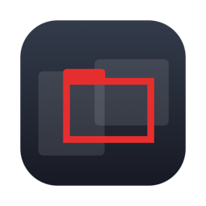
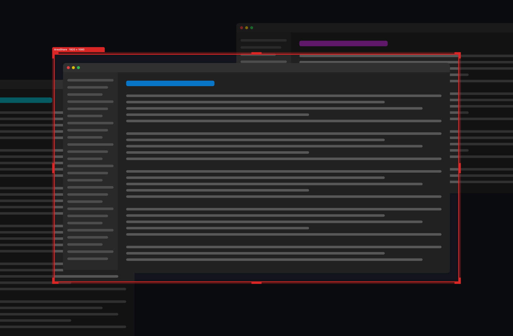

# AreaShare



AreaShare lets you share **one rectangle of a large desktop** in Microsoft Teams, Zoom, Meet or any other conferencing app that can share a window. Put the red frame around the part of the screen you want people to see, share the window called **AreaShare**, and the audience sees only what is inside the frame, at its real size, instead of a shrunken 57-inch monitor.



*The outline is drawn by the app itself; the desktop behind it is an illustration. Everything outside the frame is dimmed here to show what the audience does not see.*

There are two implementations in this folder:

| Folder | Platform | State |
| --- | --- | --- |
| `macos/` | macOS 14 or later (Swift, AppKit, ScreenCaptureKit) | The main version. |
| `windows/` | Windows 10 and 11 (Go, Win32) | Experimental: it compiles and its logic is unit-tested, but it has not been run on a real machine yet. |

## Download

Get the latest build from the [releases page](https://github.com/bbmumford/AreaShare/releases/latest).

- **macOS:** download `AreaShare-macos.zip`, unzip it and move AreaShare to Applications. The app is signed with the project's own key, not an Apple Developer ID, so the first time you open it macOS will refuse: open System Settings › Privacy & Security and choose **Open Anyway**. After that it updates itself.
- **Windows:** download `AreaShare-windows-amd64.exe` (or `arm64`) and run it.

## How it works

A conferencing app that shares a window sends that window's own picture, not whatever is behind it, so a see-through window would arrive as an empty rectangle. AreaShare uses two windows instead:

- **The frame** is the red outline with a small tab. It floats above everything. Only the outline belongs to it: the middle is empty, so you click and type in the apps underneath as usual.
- **The mirror** is a borderless window named **AreaShare** that shows a live copy of whatever is inside the frame. This is the window you share. It is exactly as large as the framed area and has no title bar, so the audience gets the framed pixels and nothing else.

## Using it (macOS)

1. Open **AreaShare** from Applications. The first time, macOS asks for Screen Recording permission: turn AreaShare on under System Settings › Privacy & Security › Screen & System Audio Recording, then choose **Relaunch**. If AreaShare is already turned on there but keeps asking (this happens when you replace it with a differently signed copy, such as one you built yourself), choose **Reset Permission** and turn it on again.
2. Drag the **tab** to move the frame. Drag the **outline** to resize it: the thick corner pieces resize diagonally, the sides resize one way. Hold **Shift** to keep the shape. An edge you drag clicks onto the edge of a window it comes close to (and onto the menu bar and Dock); hold **Command** to place it freely. The part under the pointer lights up, and the pointer changes, to show what a press will grab.
3. To fit the frame to a window, drag the tab over that window and **wiggle** it left and right. The frame snaps to the frontmost window under the pointer and flashes. Wiggle across several windows and it takes them all in one frame. It is a one-time fit: the frame does not follow the windows afterwards.
4. In your meeting choose to share a **window** and pick **AreaShare**.

Right-click the frame, or click the AreaShare icon in the menu bar, for the menu:

| Menu item | What it does |
| --- | --- |
| Pause | Freezes the shared picture on its current frame and stops recording. The outline turns amber. |
| Size | Sets the area to a standard size, keeping it centred where it was. |
| Refresh Rate | 15, 30 or 60 frames per second. |
| Show the Mouse Pointer | Includes your pointer in the shared picture. |
| Centre on This Display | Moves the frame to the middle of its display. |
| Move to Display | Shown with more than one display. |
| How to Share… | A short reminder of these steps. |
| Check for Updates… | Looks for a newer release now. |
| Check for Updates Automatically | On by default: looks once a day. |

Things to know:

- The mirror sits exactly behind the framed area, at the back of your windows, and passes every click through. You will normally never see it. Because recording leaves AreaShare's own windows out, neither the frame nor the mirror ever appears in the shared picture.
- The area is always on one display. Dragged across two, it lands on the one showing most of it.
- The tab sits above the frame, moves below it when the frame touches the top of the display, and sits inside the top-left corner when the frame is the full height of the display.
- If you stop the recording from the macOS menu-bar indicator, the outline turns amber and the menu offers **Resume**.
- Position, size, refresh rate and the pointer setting are remembered.

### Updates (macOS)

AreaShare looks at this repository's latest release once a day. When there is a newer version it does not interrupt you: the menu-bar icon gains a plus sign and the menu offers **Install AreaShare x.y.z…**. Installing downloads the new app, checks it, swaps it in and relaunches; a share in progress stops until you pick the AreaShare window again.

An update is installed only if it is signed with the same key as the copy that is running. A copy you built yourself is signed differently, so it will tell you to download the release instead. From a terminal, `/Applications/AreaShare.app/Contents/MacOS/AreaShare --check-update` prints what the updater finds and downloads and verifies an update without installing it; `--install-update` goes on to install it (quit AreaShare first, and start it again afterwards).

### Building and installing (macOS)

Requirements: Xcode 16 or newer (for the Swift toolchain).

```bash
cd macos
./build.sh            # build and sign into /private/tmp/areashare-build
./build.sh install    # the same, then replace /Applications/AreaShare.app and start it
swift test --scratch-path /private/tmp/areashare-build
```

The build directory is kept out of this folder on purpose: build products do not belong in a cloud-synced folder.

**Signing.** macOS ties the Screen Recording permission to the app's signature. `build.sh` signs with a local self-signed identity so every build has the same signature and the permission carries over; with an ad-hoc signature you would have to grant it again after every build. `Scripts/make-identity.sh` creates the default identity, `AreaShare Local`, in the login keychain (macOS asks for the login password the first time `codesign` uses it). To use another identity, set `AREASHARE_SIGN_IDENTITY` or put its name in `macos/.signing-identity`; `-` means ad-hoc.

**The ReadMe picture.** `docs/images/frame.png` is made without photographing a screen: `AreaShare --render-frame outline.png 1920 1080 260` writes the outline as the app draws it, and `swift Scripts/make-readme-image.swift outline.png 260 260 1920 1080 ../docs/images/frame.png` lays it over a drawn stand-in desktop.

**One private call.** The frame never activates the app, and macOS ignores pointer-shape changes from a background app. `BackgroundCursor.swift` turns on a window-server switch that is not in the public headers so the resize pointers appear. It is looked up by name at run time; if a future macOS removes it, the frame keeps working with the plain arrow.

| Path | Contents |
| --- | --- |
| `macos/Sources/AreaShareCore` | Frame layout, hit-testing, drag rules, settings. No windows; unit-tested. |
| `macos/Sources/AreaShare/AppDelegate.swift` | Owns the region; keeps frame, mirror, recorder and menus in step. |
| `macos/Sources/AreaShare/FrameWindow.swift` | The outline: drawing and pointer handling. |
| `macos/Sources/AreaShare/MirrorWindow.swift` | The window that is shared. |
| `macos/Sources/AreaShare/CaptureEngine.swift` | The ScreenCaptureKit stream of the region. |
| `macos/Sources/AreaShare/Updater.swift` | Finds, verifies and installs new releases. |
| `macos/Scripts` | Icon drawing, the signing-identity script, and the ReadMe picture. |

## Releasing

Pushing a tag of the form `v1.4.2` runs `.github/workflows/release.yml`, which tests and builds both apps with that version, signs the macOS app with the release key, and publishes `AreaShare-macos.zip`, the two Windows executables and their SHA-256 sums as a GitHub release. That release is what installed copies update to.

```bash
git tag v1.4.2 && git push origin v1.4.2
```

The release key is a self-signed code-signing certificate kept in the repository secrets `MACOS_SIGNING_P12` (base64 of the PKCS#12 file) and `MACOS_SIGNING_PASSWORD`. It must stay the same from release to release: macOS ties the Screen Recording permission to it, and installed copies refuse updates signed with anything else.

Every push and pull request runs `.github/workflows/ci.yml`: the tests and an unsigned build of both apps.

## Windows

The Windows version follows the same two-window design with a few differences forced by the platform:

- The screen is copied with GDI, which cannot leave a window out, so the mirror is moved to a monitor corner the frame does not cover (another monitor if there is one) and pinned behind all other windows. You may see it on bare desktop.
- If the framed area is so large that no such corner exists, the mirror is parked off the right edge of the desktop. Windows may stop updating a window that is entirely off screen, so **keep the area smaller than half the desktop** until this has been tried on a real machine.
- Right-click the frame for the menu. Settings are stored in `%AppData%\AreaShare\config.json`.
- **Check for updates…** in the menu compares your version with the latest release and offers to open the download page. The Windows app does not replace itself.

```powershell
cd windows
go build -ldflags "-H=windowsgui -s -w" -o AreaShare.exe .
go test ./...
```

Requires Go 1.25 or newer. From macOS or Linux prefix the build with `GOOS=windows GOARCH=amd64` (or `arm64`). The result is unsigned, so SmartScreen may warn on first run.

## License

MIT.
